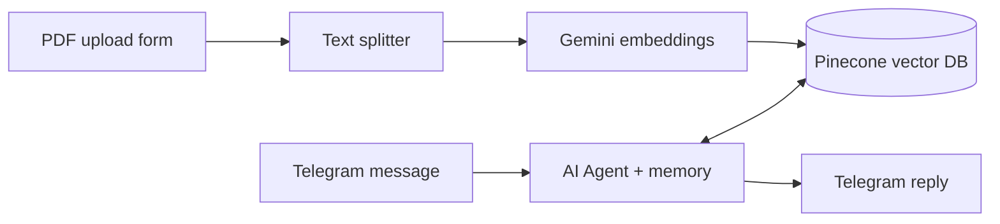

# Telegram RAG Chatbot (n8n + Gemini + Pinecone)

A Telegram bot that answers questions from my own documents using
Retrieval-Augmented Generation (RAG). Answers are grounded in the
uploaded document, and if the information isn't there, the bot says so.

**Try the bot:** https://t.me/vinutha_resume_bot (may be offline after my n8n trial ends)

## How it works

### Workflow 1: Ingestion (`workflow-1-upload.json`)
Upload a PDF, split it into 1000-character chunks (200 overlap), convert each chunk to vectors with Gemini embeddings, and store them in Pinecone.

### Workflow 2: Chatbot (`workflow-2-telegram-bot.json`)
A Telegram message triggers an AI Agent. The agent searches Pinecone for the 4 most relevant chunks, answers using only that context, and replies on Telegram. Per-chat memory keeps follow-up questions working.

## Tech stack
n8n, Google Gemini (chat + embeddings), Pinecone, Telegram Bot API

## Screenshots
[drag your screenshots here while editing]

## How to run it yourself
1. Create accounts: n8n, Google AI Studio, Pinecone, Telegram (@BotFather)
2. Create a Pinecone index: dimension 3072, cosine
3. In n8n: Workflows, Import from file, import both JSON files
4. Add your own credentials (Gemini, Pinecone, Telegram)
5. Run the upload workflow with a PDF, then publish the bot workflow

## What I learned
- How RAG works: chunking, embeddings, vector search
- Wiring an AI agent with tools and memory
- Debugging real issues: embedding dimension mismatch, API rate limits
- How RAG works: chunking, embeddings, vector search
- Wiring an AI agent with tools and memory
- Debugging real issues: embedding dimension mismatch, API rate limits
